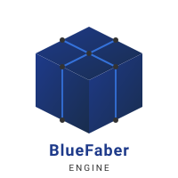

  <strong>English</strong> · <a href="./docs/i18n/README.ru.md">Русский</a> · <a href="./docs/i18n/README.es.md">Español</a> · <a href="./docs/i18n/README.hi.md">हिन्दी</a> · <a href="./docs/i18n/README.zh-CN.md">简体中文</a> · <a href="./docs/i18n/README.ja.md">日本語</a>

<h1 align="center">
  <picture>
    <source media="(prefers-color-scheme: dark)" srcset="./assets/bluefaber-dark.svg">
    
  </picture>
</h1>

<strong>A visual node editor for Minecraft Java Edition mods and server plugins</strong>

<code>On first join</code> → <code>Give starter kit</code>

BlueFaber Engine is in development. The goal is to start with a blank graph or an existing JAR, edit the logic as nodes, and rebuild for a supported game version and platform.

Forge · NeoForge · Fabric &nbsp; / &nbsp; Bukkit · Spigot · Paper

  <a href="./docs/ROADMAP.md">Roadmap (in Russian)</a> · <a href="https://github.com/users/Arkomiko/projects/6/views/6">Project board</a>

