<a href="docs/en-US/README.md">English</a> &nbsp;·&nbsp; <a href="docs/ru-RU/README.md">Русский</a> &nbsp;·&nbsp; <a href="docs/es-ES/README.md">Español</a> &nbsp;·&nbsp; <a href="docs/hi-IN/README.md">हिन्दी</a> &nbsp;·&nbsp; <a href="docs/zh-CN/README.md">简体中文</a> &nbsp;·&nbsp; <a href="docs/ja-JP/README.md">日本語</a>

<picture>
  <source media="(prefers-reduced-motion: reduce)" srcset="assets/portal-still.svg">
  
</picture>

<h1 align="center">BlueFaber Engine</h1>

<strong>Port Minecraft Java Edition mods and plugins between versions and platforms.</strong>

Open an existing JAR or start with an editable node graph. Follow recovered logic back to its source, make changes, and build for a selected target. BlueFaber Engine is in development.

<a href="docs/README.md"><strong>Documentation</strong></a> &nbsp;·&nbsp; <a href="docs/en-US/PORTING-FIRST.md">First port</a> &nbsp;·&nbsp; <a href="https://github.com/users/Arkomiko/projects/6/views/6">Project board</a>

## Find your way

| Plan the work | Inspect a port | Explore the templates |
| --- | --- | --- |
| [Roadmap](docs/en-US/ROADMAP.md) · [Backlog](docs/en-US/BACKLOG.md) | [Porting matrix](docs/en-US/PORTING.md) · [Java recovery](docs/en-US/JAVA-RECOVERY.md) | [BLUSTREE and BLUSMOR](docs/en-US/TEMPLATES.md) |

## Licensing and usage terms

BlueFaber-Engine is **source-available** under the **PolyForm Noncommercial License 1.0.0**. It does not meet the OSI Open Source Definition because commercial use is restricted. The license permits use, changes and distribution for its stated purposes, including qualifying personal, educational, hobby, research and nonprofit uses. Commercial uses outside the license’s permissions, such as selling the tool, reselling it or offering it as a paid service, require prior written permission from Arkomiko. [Open Source Definition](https://opensource.org/osd)

Voluntary donations and sponsorship support development. They are not purchases and grant no extra rights. The license covers the tool. Users choose how to license and distribute original mods, modpacks, plugins, resource packs and other material they own. Third-party code and assets retain their own terms.

Where a profile uses official Minecraft mappings, Mojang or Microsoft terms apply. The project does not distribute those mappings as a standalone product. Review the terms for the selected version and the Minecraft EULA. [Minecraft EULA](https://www.minecraft.net/en-us/eula) · [Licensing guide](docs/en-US/LICENSING.md)

  
  
  

