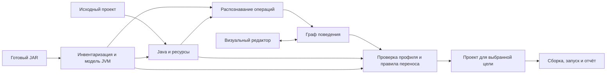

<picture>
  <source media="(prefers-reduced-motion: reduce)" srcset="../assets/docs-flow-still.svg">
  
</picture>

# Архитектура BlueFaber Engine

[Главная](../README.md) · [Карта разработки](ROADMAP.md) · [Восстановление Java](JAVA-RECOVERY.md) · [Перенос](PORTING.md)

На этой странице

- [Один проект и три уровня представления](#один-проект-и-три-уровня-представления)
- [Поток данных](#поток-данных)
- [Формат проекта](#формат-проекта)
- [Исполнение, типы и эффекты](#исполнение-типы-и-эффекты)
- [Компоненты и технологии](#компоненты-и-технологии)
- [Генерация и контроль изменений](#генерация-и-контроль-изменений)
- [Интерфейс и отладка](#интерфейс-и-отладка)
- [Результаты, которые должны различаться в интерфейсе](#результаты-которые-должны-различаться-в-интерфейсе)

[Поэтапная карта](ROADMAP.md) · [Восстановление Java](JAVA-RECOVERY.md) · [Перенос и Mixin](PORTING.md) · [Кандидаты GitHub](RESEARCH.md)

## Один проект и три уровня представления

**Граф поведения** описывает редактируемую часть проекта в терминах Minecraft и Java. В нём хранятся события, условные переходы, функции и декларации контента. У рецепта, модели и правила генерации мира есть связи с ресурсами проекта. Типы и эффекты узлов позволяют проверить, доступна ли операция для выбранной цели. Положение узлов, масштаб и выделение хранятся отдельно. Перемещение узла по холсту не меняет сборку.

**Структурированное представление Java** содержит дерево исходного кода и результаты разрешения имён. Его можно использовать, чтобы показать или изменить вручную написанный обработчик, проверить перегрузку и сгенерировать Java с привязкой строк к узлам. Исходный файл может содержать код, для которого ещё нет нод.

**Представление JVM** содержит классы, инструкции, базовые блоки, нормальные и исключительные переходы, типы стека, метаданные и ссылки на исходные байты. Оно позволяет инспектировать поведение, даже если Java-декомпилятор не восстановил метод. При импорте повышения уровня идут от подтверждённых JVM-фактов и разрешённых символов Java к узлам Minecraft. [Формат class file](https://docs.oracle.com/javase/specs/jvms/se25/html/jvms-4.html), [ASM](https://asm.ow2.io/)

Первый прототип хранит граф поведения между запусками. Деревья Java и JVM-кэши пересчитываются из источников по хешам и версиям анализаторов. Это ограничивает число форматов, которые потребуется мигрировать при обновлении редактора.

## Поток данных

Узел рецепта ссылается на предметы по их ключам в реестре. У руды отдельный узел задаёт минимальный инструмент и связывает блок с результатом добычи. Адаптер выбранной цели реализует регистрацию блоков и предметов, проверку инструмента и сериализацию таблицы лута. Редактор связывает диагностику с узлом и путём ресурса. [Сквозная проверка на Blusmor](BLUSMOR.md)

## Формат проекта

Это начальное предложение по структуре рабочего пространства редактора. Для экспорта в IDE генератор раскладывает исходники и ресурсы по стандартным каталогам Gradle выбранной платформы. [Состав восстановленного проекта](JAVA-RECOVERY.md)

| Часть проекта | Содержание |
| --- | --- |
| **project.json** | Идентификатор проекта, версия схемы, точки входа, списки графов, профилей и исходников. |
| **graphs/** | Документ на обработчик, функцию или группу деклараций контента. Стабильные идентификаторы узлов и портов, параметры типов, связи исполнения и данных, типизированные границы Java. |
| **layout/** | Позиции, группы, комментарии холста, состояние свёрнутых узлов. Загрузка семантики доступна без этих файлов. |
| **src/** и **resources/** | Ручная Java и другие исходники, конфигурация платформы, ресурсы и результаты импорта с указанием происхождения. |
| **targets/** | Версия Minecraft, загрузчик или API, профили Java, mappings, адаптер, политика редактируемости и закреплённые зависимости. |
| **import/** | Манифест входного JAR, результаты распознавания, связи Java ↔ JVM ↔ граф, пути к локальным копиям артефактов. |
| **build/** | Временный и экспортируемый результат генерации, журналы, карта строк и отчёты. Ручные исходники лежат в других каталогах. |

- Узел хранит идентификатор вида операции, версию описания операции, параметры, порты и источник. Источником может быть ручное создание, Java-файл или JVM-метод с дескриптором и диапазоном инструкций. Дополнительно указывается уверенность распознавания и условия реализации.
- Описание операции регистрирует типы портов, разрешённые преобразования, эффекты, сторону и фазу исполнения. Оно также говорит, какую версию каталога нужно загрузить. Неизвестный узел получает место на холсте, сохраняется со всеми полями и блокирует сборку активного графа, если требуемого генератора нет.
- Схема задаёт уникальность идентификаторов, направление портов, кратность связей и проверку ссылок. Миграции идут между зафиксированными версиями схемы. Перед записью миграции проверяются, исходная копия доступна для восстановления.
- Переменные функции и поле объекта имеют разные области видимости и правила инициализации. Для постоянного игрового состояния граф описывает область, срок жизни и способ сохранения. У размещённого блока отдельно учитываются ключ реестра и состояние в чанке, у предмета в инвентаре — ключ и количество в стеке.
- Сохранение документа атомарное. Для чтения и сборки берётся снимок ревизии, а результат ссылается на его хеш. Изменение открытого графа во время сборки помечает результат как устаревший.

## Исполнение, типы и эффекты

| Вопрос | Правило для первой реализации |
| --- | --- |
| Когда запускается действие? | Входной порт исполнения и текущий обработчик определяют порядок. Ветвление, цикл и завершение выражены явно. Обратная связь задаётся через узел цикла или рекурсию. |
| Когда вычисляется значение? | Узлы без эффектов работают как выражения. Чтение меняющегося игрового состояния и вызовы с эффектом имеют закреплённый момент выполнения. Порядок Java учитывается при разворачивании выражения. |
| Что делает соединение допустимым? | Тип, направление, обобщённые параметры, nullability и доступность на целевом профиле. Расширяющийся Java-тип или конвертирующий узел допускаются по явным правилам. Для вызовов сохраняется выбранная перегрузка. |
| Где обрабатываются исключения? | В Java-части сохраняются исключительные переходы. В нодовой части обработка исключения, разрешённый выход из функции и очистка ресурсов выражаются структурированно. Не распознанный поток остаётся в Java или JVM-представлении. |
| Кто обращается к миру? | Узел сообщает, где разрешён эффект. Вызов из асинхронного контекста требует явного перехода на допустимый поток и учитывает отмену и завершение сервера. |
| Как вызывается неизвестный Java-код? | Через типизированную границу с JVM-дескриптором и требованиями к зависимостям. Профиль допускает такой код после проверки доступности символов и семантики вызова. |

Для первого выпуска достаточно управляющих узлов с определённой семантикой, включая Branch, Sequence, Loop, Return, событие, вызов функции и работу с переменными. Сложные методы получают просмотр по функциям и базовым блокам. Автоматическое распознавание целого обработчика требует совпадения потока, эффектов, условий и границы вызова. Предложение открыть отдельные операции в нодах сохраняет связь с окружающим Java-кодом.

## Компоненты и технологии

| Компонент | Начальный выбор | Что проверить |
| --- | --- | --- |
| Компилятор и CLI | Java с современным JDK, Gradle, без зависимости от UI. | Библиотеки байткода, mappings и API загрузчиков работают в отдельных задачах. Выходной JAR получает собственную версию Java. |
| Редактор | React и TypeScript с управляемым холстом React Flow. | Сравнить с адаптацией PluginBlueprint. Проверить типизированные порты, подграф, undo/redo, автокомпоновку и виртуализацию на крупной фикстуре. |
| Связь с ядром | Версионированный обмен JSON между локальным UI и Java-процессом. Для первого настольного прототипа достаточно stdin/stdout с границами сообщений. | Редактор отслеживает прогресс и отмену. Диагностики имеют стабильный код, место, серьёзность и привязку к снимку проекта. |
| Пакетирование | Выбрать после прототипа UI. Electron упрощает переиспользование наработок PluginBlueprint. Tauri требует проверки упаковки и запуска JVM. | Проверить размер дистрибутива, обновление JRE, сборку под Windows, обработку путей с пробелами и остановку дочерних процессов. |

Kotlin подходит для части JVM-ядра при подтверждённой пользе на прототипе. TypeScript ведёт взаимодействие и рисует редактор. Разрешение перегрузок, валидация графа, генерация и перенос принадлежат JVM-ядру и используются одной командной реализацией. Общую схему сообщений проверяют тесты обеих сторон. [React Flow](https://github.com/xyflow/xyflow), [PluginBlueprint](https://github.com/InventivetalentDev/PluginBlueprint)

## Генерация и контроль изменений

1. Проверить схему, разрешить зависимости графа и построить снапшот целевого профиля. Определить, какие обработчики и сущности реально входят в сборку.
2. Применить направленные правила переноса и получить список выбранных замен. Ошибки и деградации привязать к первичному источнику. Пользовательские решения сохранить рядом с профилем для повторной сборки.
3. Генерировать стабильный Java-код, метаданные, ресурсы, конфигурацию и шаблон Gradle. Карта узлов к строкам остаётся доступной после компиляции, а шаблоны сборки обновляются отдельно от пользовательских исходников.
4. Выполнять повторную генерацию во временный каталог и публиковать целиком после успешной проверки. Одинаковый вход должен давать одинаковую структуру файлов.
5. Если пользователь открыл сгенерированный Java в IDE и изменил его, показать разницу. Перенос участка под ручное управление или импорт изменений в граф выполняется явным действием. Сохранение графа не затирает обнаруженную правку.

## Интерфейс и отладка

- **Создание.** Палитра фильтруется по цели, типу активного порта и доступной фазе. Видны причины, почему соединение запрещено. Инспектор показывает типы, значения по умолчанию, поддержку на выбранных целях.
- **Импорт.** Показывать дерево JAR, отчёт об окружении, подтверждённые узлы, Java и JVM-инструкции с переходами по единой карте происхождения. Поддержать применение предложений для отдельных функций.
- **Проверка.** Для одной цели показывать список блокеров, затронутых узлов и ручных исправлений. Для нескольких целей добавлять сводную матрицу. Результат миграции доступен как дифф до генерации.
- **Отладка.** В первом релизе навигация из ошибки компиляции или stack trace к узлу и Java-строке. После неё — пошаговое выполнение и просмотр значений в отдельном отладочном запуске. Инструментация сохраняет границы полномочий и состояние оригинального сценария.
- **Большие проекты.** Проект открыт по функциям и пакетам, а анализ идёт фоновыми задачами. Холст отображает текущий подграф, показывает свёрнутые узлы и не разворачивает автоматически весь JAR. Порог интерактивности проверяется на закреплённых примерах.

## Результаты, которые должны различаться в интерфейсе

| Статус | Что установлено |
| --- | --- |
| Распознан | Определены входные данные и предполагаемый профиль. |
| Восстановлен частично | Файлы и пригодный код открываются. Причины пробелов указаны в отчёте. |
| Собран | JAR получен на совпадающем профиле. Проверка исполнения ещё отдельна. |
| Порт запускается | Целевой сервер или клиент загрузил именно опубликованный JAR. |
| Поведение проверено | Сценарии из отчёта пройдены на отмеченных целях, версиях и сторонах. |
| Требует решения | Ожидается зависимость, проверка предлагаемого преобразования, допустимая эмуляция или ручная правка. |

В каждом отчёте доступны исходный и целевой профили, версии правил, пути к материалам проверки и команды для повторного прогона. Состояние «требует решения» может сочетаться с частичной сборкой, если сборка явно помечена как неполный перенос.
