<picture>
  <source media="(prefers-reduced-motion: reduce)" srcset="../assets/docs-flow-still.svg">
  
</picture>

# BLUSTREE и BLUSMOR

[Главная](../README.md) · [Карта разработки](ROADMAP.md) · [Базовый BLUSMOR](BLUSMOR.md) · [Матрица целей](PORTING.md)

На этой странице

- [Контракт пакета](#контракт-пакета)
- [BLUSTREE — Дерево Блус](#blustree--дерево-блус)
- [BLUSMOR — Блусмор](#blusmor--блусмор)
- [Порядок использования в разработке](#порядок-использования-в-разработке)

Оба шаблона — пакеты связанных узлов BlueFaber для Minecraft Java Edition. Автор добавляет пакет в пустой или существующий проект, видит весь граф, меняет его и собирает под выбранную цель. Свойства, ресурсы и связи доступны теми же средствами, которыми создаётся граф с нуля. После вставки проект владеет своей копией. Обратный импорт проверяется на отдельно собранном моде без встроенного графа.

## Контракт пакета

- Пакет включает граф, ресурсы с происхождением, пространство имён, ограничения профиля и ожидаемые результаты проверок. Раскрываемый подграф показывает его внутренние связи. Правки вложенного узла сохраняются вместе с проектом.
- При вставке редактор показывает коллизии ID и возможность выбрать новое пространство имён. Переписываются ссылки на выбранные объекты. Пользовательские ссылки наружу и ссылки на ваниль сохраняются. Два экземпляра можно проверить и собрать вместе.
- У каждого исходного узла есть адрес в диагностике и связь с сгенерированным классом или ресурсом. Версионная замена применяется с предпросмотром. При дополнительном ручном Java-коде сохраняется его собственность и источник.
- Профиль проверяется по возможностям. При отсутствии реестра, транспорта, сетевого или клиентского API отображаются конкретный узел, причина и доступные варианты. Выбор эмуляции сохраняется в отчёте как отдельный результат.

## BLUSTREE — Дерево Блус

| Подграф | Возможности | Испытание |
| --- | --- | --- |
| Дерево | Брёвна, древесина, обтёсанные варианты, листва, саженцы | Рост саженца, состояния оси бревна, добыча, распад листвы и шанс дропа. |
| Строительство | Доски, ступени, плиты и дополнительные строительные блоки | Рецепты и количества, размещение по граням и состояния соседних блоков. |
| Двери и ограды | Двери, люки, заборы и калитки | Половинки и петли, открытие и питание, соединение с соседними блоками. |
| Инструменты | Деревянный меч, лопата, кирка, топор и мотыга | Различия в скорости, прочности, ремонте, крафте и корректности добычи. |
| Транспорт | Лодка и вариант с сундуком | Спавн, посадка, инвентарь, сохранение, возобновление и тест на клиенте и сервере. |
| Изделия | Палочки, таблички, подвесные таблички, кнопки, нажимные плиты, сундуки и другие изделия по каталогу | Каждый элемент каталога имеет рецепт или другое правило получения, модель, перевод и собственный сценарий проверки. |

## BLUSMOR — Блусмор

Базовый набор включает обе разновидности руды, сырьё, слиток и блоки хранения. Их идентификаторы, рецепты, теги, генерация и локализация описаны отдельно. [Базовый контракт Blusmor](BLUSMOR.md)

| Подграф | Возможности | Испытание |
| --- | --- | --- |
| Материал | Руды, сырьё, слитки, самородки и блоки хранения | Проверить добычу правильным инструментом, генерацию в камне и глубинном сланце, печь, плавильню, количество при упаковке и распаковке. |
| Оружие и инструменты | Меч, кирка, лопата, топор, мотыга и расширяемый уровень материала | Проверить урон, скорость, добычу, износ, ремонт и рецепты. |
| Броня | Предметы брони, комплект и конская броня | Проверить экипировку, параметры, внешний вид и ограничения профиля. |
| Строительство | Блоки, плиты, ступени, металлические аналоги дверей, люков, заборов и калиток | Проверить формы и состояния, крафт, питание и совместимость механик со свойствами металла. |
| Транспорт | Лодки и вагонетки | Снять эталон управления и движения, сохранения, дропа и поведения сети. |
| Рельсы и механизмы | Рельсы, переключение и питание, механизмы по каталогу | Проверить состояние при смене питания, движение вагонетки и результат после перезапуска. |
| Вёдра и изделия | Ведро, поддерживаемые жидкости, прочие изделия | Проверить перемещение жидкости, возвращаемый предмет и исключения при обмене ёмкостей. |
| Трезубец | Предмет и снаряд, бросок и возвращение | Проверить столкновение, урон, подбор и частные состояния клиент ↔ сервер. |
| Громоотвод | Направление, удар молнии и сигнал | Проверить притяжение молнии, выходной сигнал, сброс состояния и разные ориентации блока. |

У дополнительных механик есть явные параметры. У металлической лодки это поведение на воде, у двери — реакция на взаимодействие при выключенном питании, у ведра — перечень жидкостей. Дополнительные свойства, включая окисление, проходят отдельное испытание переходов состояния и сохранений.

## Порядок использования в разработке

1. Первым взять базовый граф BLUSMOR. Для переноса достаточно рецепта, модели предмета и одного правила поведения с измеримым результатом.
2. Добавить минимальный BLUSTREE из бревна, досок и рецепта. Проверить повторное использование узлов на двух разных материалах.
3. Прогнать выбранный контрольный мод на исходной и целевой среде. После этого расширять пакеты подграфами и добавлять генерацию мира, транспорт, боевые и сетевые механики по отдельным задачам.
4. Сравнить копирование, правку, импорт и перенос в обе стороны. Успех по каждому подграфу фиксируется только с конкретным профилем и результатом в игре.

[Этапная карта](ROADMAP.md) · [Доска этапов](https://github.com/users/Arkomiko/projects/6/views/6)
