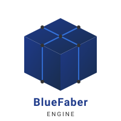

  <a href="../../README.md">English</a> · <a href="./README.ru.md">Русский</a> · <a href="./README.es.md">Español</a> · <a href="./README.hi.md">हिन्दी</a> · <a href="./README.zh-CN.md">简体中文</a> · <strong>日本語</strong>

<h1 align="center">
  <picture>
    <source media="(prefers-color-scheme: dark)" srcset="../../assets/bluefaber-dark.svg">
    
  </picture>
</h1>

<strong>Minecraft Java Edition の MOD とサーバープラグインのためのビジュアルノードエディター</strong>

<code>プレイヤーの初参加時</code> → <code>初期アイテムを配布</code>

BlueFaber Engine は現在開発中です。空のグラフから作成したり、既存の JAR ファイルを読み込んだりして、ノードでロジックを編集し、対応するゲームバージョンとプラットフォーム向けに再ビルドできるようにすることを目指しています。

Forge · NeoForge · Fabric &nbsp; / &nbsp; Bukkit · Spigot · Paper

  <a href="../../docs/ROADMAP.md">開発ロードマップ（ロシア語）</a> · <a href="https://github.com/users/Arkomiko/projects/6/views/6">プロジェクトボード</a>

